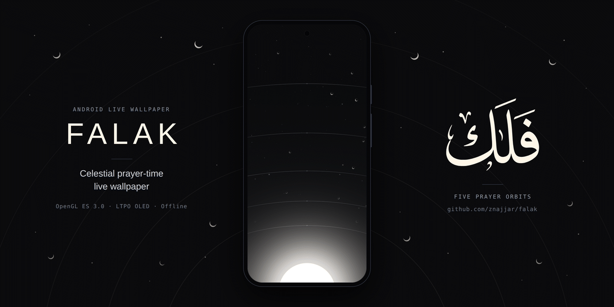

# Falak — Celestial Prayer-Time Live Wallpaper

An original OpenGL ES 3.0 Android live wallpaper that scales cleanly to **any vertical phone screen size and aspect ratio** (`16:9` through `22:9+` and portrait foldables) and is optimized for **LTPO OLED** displays, visualizing daily Islamic prayer times anywhere in the world as five orbiting planets around a rising star.

<p align="center">
  
  <br />
  <sub><em>Asr prayer alignment (15:14, Amman) — planet crossing the center meridian as the starfield gently sprinkles</em></sub>
</p>

## Download
- **[All Releases](https://github.com/znajjar/falak/releases)** (APK packaged at `dist/falak.apk`)

## Features & Visual Design
- **Universal Vertical Screen Scaling**: Automatically adapts the rising star (`35%` visible above the bottom edge), orbital line crispness, starfield pinpoint scale, and UI insets (status bars & camera cutouts) to any Android phone resolution, density, and vertical aspect ratio (`16:9`, `18:9`, `19.5:9`, `20:9`, `21:9`, `22:9`, and portrait foldables).
- **Worldwide Manual Location Selector (Zero Permissions)**: Pick manually from **145 built-in world cities** (searchable offline) or enter **custom coordinates & IANA timezone** for any location on Earth—with **zero location or internet permissions** requested.
- **Selectable Calculation Sources**: Switch between **Jordan Ministry of Awqaf** (`Fajr 18° / Maghrib 2.12° / Isha 18°`, Standard Asr, calibrated to the Hashemite Jordanian calendar) and **Muslim World League (MWL)** (`Fajr 18° / Isha 17°`, Standard Asr). Also accessible directly via Android's live wallpaper settings gear.
- **Continuous ~24h Orbits Anywhere on Earth**: Powered by an offline Jean Meeus / NOAA astronomical solar solver with full IANA timezone/DST support and continuous angle-based high-latitude twilight handling. Each planet interpolates continuously across consecutive days—adapting smoothly with zero midnight jump—and crosses dead center at exact prayer time.
- **Rising Pulsating Star & Coupled Planet Reflections**: A warm incandescent ivory star rises `35%` above the bottom edge of the screen with a lush `1.5×` corona glow against a deep obsidian-grey sky (`#0B0B0D` → `#111214`). During prayer time, the star gently breathes and pulsates, casting its shifting radiance across the illuminated hemispheres and rims of all five 3D planets.
- **Customizable Starfield, Crescents & Prayer-Time Glitter**: Sparse, varied-size pinpoint stars and delicate celestial crescents (hilal) scaled to display resolution with `1×1` OLED micro-dither to eliminate dark-grey banding. Around each prayer time, the sky softly sprinkles with twinkling diamond pinpoints and shimmering crescents—with live in-app sliders to tune **Star Size**, **Star Density**, and **Glitter Speed**.
- **Five Active Prayer Orbits**: Only the five prayer orbits (**Fajr**, **Dhuhr**, **Asr**, **Maghrib**, **Isha**) arc upward across the screen, marked with subtle center alignment dots and localized orbital trails.
- **Optimized for LTPO OLED**: Renders at `1 Hz` while idle, ramps smoothly to `30 FPS` during prayer-time sprinkle windows, and sleeps at `0 Hz` when hidden or screen-off.

## Project Layout
- `model/falak.vert` & `model/falak.frag` — Portable GLSL ES 3.00 responsive analytic 3D shader (Android OpenGL ES 3.0 & WebGL2)
- `model/scene_config.json` — Scene, display scaling, and calculation source configuration
- `preview/` — Interactive WebGL2 browser preview (with screen ratio, manual location & source selectors), snapshot renderer, and Asr GIF generator
- `android/` — Pure Android framework Gradle project (`com.falak.livewallpaper`, `minSdk = 29`, `targetSdk = 35`, zero external dependencies)

## Building

```bash
cd android
gradle assembleDebug --no-daemon
adb install -r app/build/outputs/apk/debug/app-debug.apk
```
